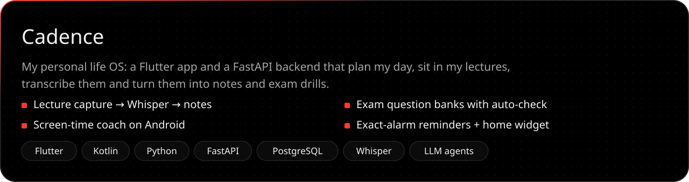
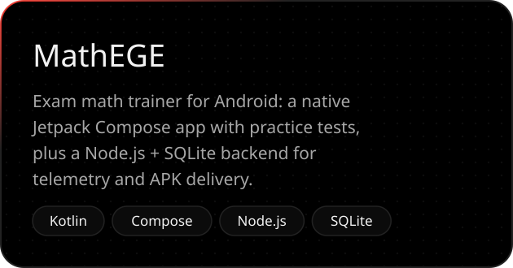
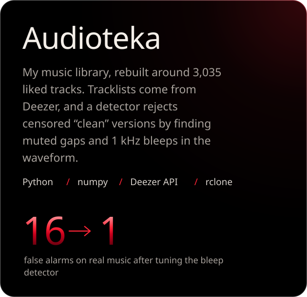
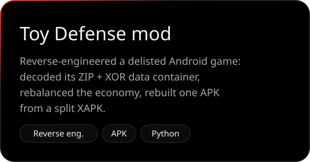
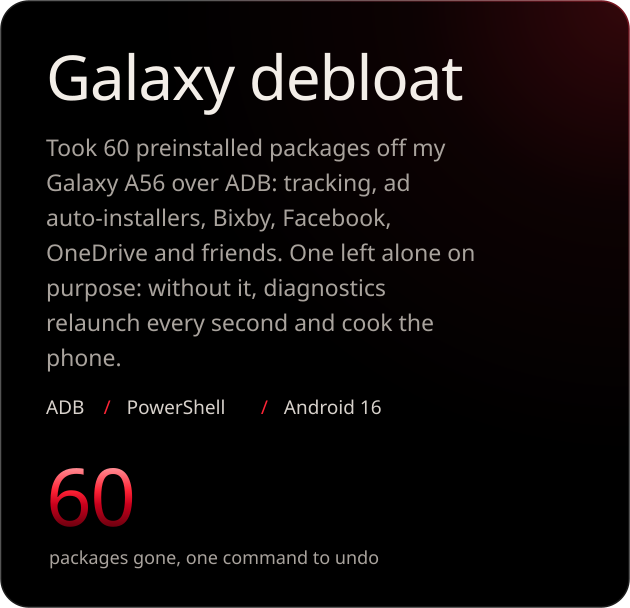
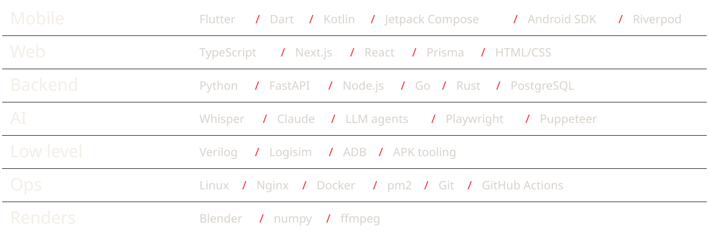

  

I build things that run on their own: AI pipelines that listen, transcribe and plan, apps I use every day, and tools for taking other software apart to see how it works.

Most of my code lives in private repos. These are the projects I can show.

  
  

  
  

<picture>
  <source media="(prefers-color-scheme: dark)" srcset="https://raw.githubusercontent.com/aleksikgod/aleksikgod/output/snake-dark.svg">
  <source media="(prefers-color-scheme: light)" srcset="https://raw.githubusercontent.com/aleksikgod/aleksikgod/output/snake-light.svg">
  
</picture>
